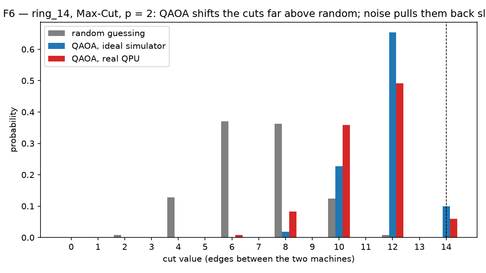
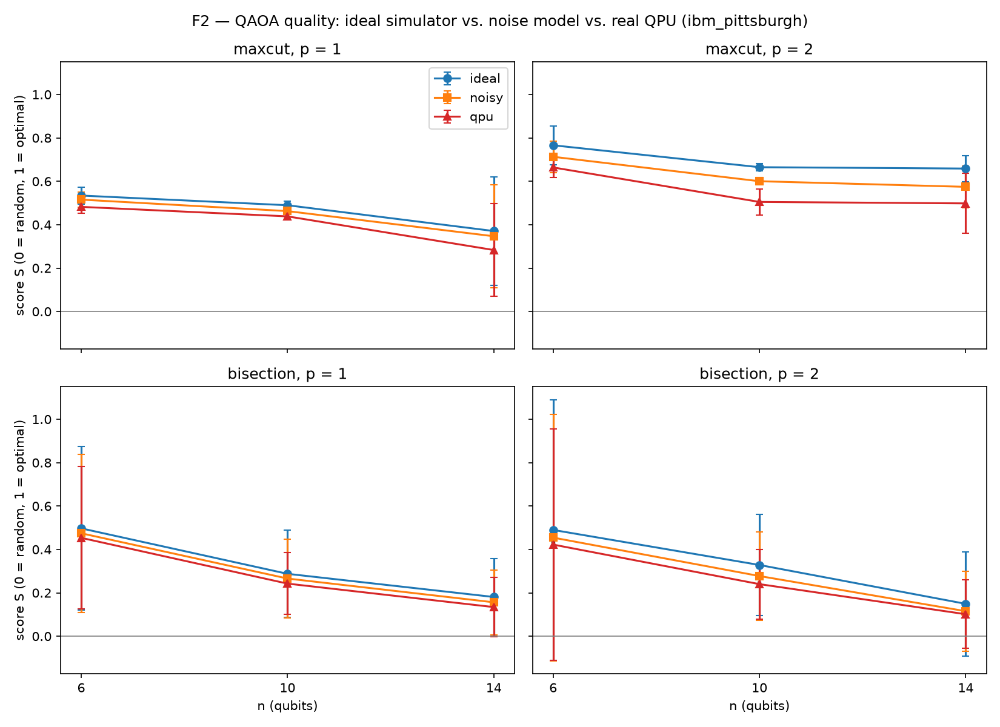
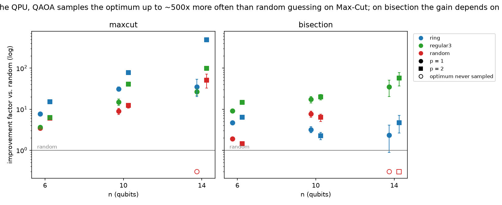
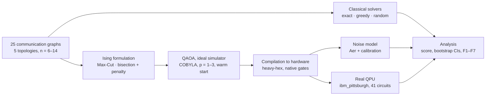

# Distributed Process Allocation: Quantum vs. Classical Optimisation

Placing communicating processes on two machines is a constrained graph-partitioning problem: minimise inter-machine traffic while keeping the load balanced.
This project formulates it as a binary optimisation problem and solves it three ways: exact enumeration, greedy local search, and the
Quantum Approximate Optimization Algorithm (QAOA) running on a real IBM quantum processor. It measures what each method delivers,
and what the balance constraint and real hardware cost.



*ring_14, Max-Cut, p = 2: random placement separates 7 of 14 edges on average, ideal QAOA 11.7, the real QPU (ibm_pittsburgh) 11.0.*

---

## The placement problem

A distributed application is a graph: processes (services, MPI ranks, actors) are nodes, and an edge joins two processes that interact.
Assigning every process to one of two machines splits the graph in two, and two placement policies correspond to two classic optimisation problems:

| policy | edge means | objective | constraint | problem |
|---|---|---|---|---|
| **affinity**: keep chatty processes together | the two processes exchange messages | **minimise** edges between machines (network traffic) | equal number of processes per machine (load balance) | **minimum bisection** (NP-hard) |
| **anti-affinity**: keep interfering processes apart | the two processes contend for a resource | **maximise** edges between machines | none | **Max-Cut** (NP-hard) |

A placement is a bit string $x \in \{0,1\}^n$, where $x_i$ is the machine of process $i$. Both problems become a minimum-energy search over
an Ising Hamiltonian, the form a quantum optimiser accepts:

$$
H_{\text{Max-Cut}} = -\sum_{(i,j)\in E} \tfrac12\,(1 - Z_iZ_j),
\qquad
H_{\text{bisection}} = \sum_{(i,j)\in E} \tfrac12\,(1 - Z_iZ_j) \;+\; A\Big(\sum_i Z_i\Big)^2 .
$$

Max-Cut maps directly; bisection needs its load-balance constraint added as a **penalty term**, whose weight $A$ must be large enough that
no unbalanced placement ever wins. Solving both on the same graphs isolates the price of a hard constraint for a quantum optimiser.

## Questions

| | question | answered in |
|---|---|---|
| **Q1** | Without noise, how close does QAOA get to the optimal placement, and does more circuit depth help? | F1 |
| **Q2** | How much of that quality survives on a real QPU, and can it be predicted before running? | F2, F7 |
| **Q3** | On hardware, does QAOA find the optimal placement more often than random assignment? | F3 |
| **Q4** | How does it compare with classical methods? | F4 |
| **Q5** | What does the load-balance constraint cost, on the same graph? | F5 |

## Key results

- **Unconstrained placement works on real hardware up to 14 processes.** For Max-Cut the QPU samples the optimal placement **up to ~500× more often**
  than random assignment, and a deeper circuit is worth its extra noise (n = 14: score 0.50 at p = 2 vs. 0.28 at p = 1).
- **The load-balance constraint is the bottleneck.** The penalty couples every pair of processes, so bisection circuits need **4–9× more two-qubit gates**
  than Max-Cut on the same sparse graph. At 14 processes, constrained placement drops to random level on two of three graphs.
- **Execution quality can be bracketed before running.** A noise model built from the device calibration explains **~48%** of the measured loss and is always
  optimistic; the estimated success probability (ESP) is almost always pessimistic but ranks circuits correctly (correlation **0.84**).
  29 of 38 outcome predictions made before submission were correct.
- **The measurements are robust.** 95% bootstrap intervals are ±0.01 in score; repeating three circuits a day later changed scores by ≤ 0.02.
- **Classical heuristics still win at this scale.** Greedy local search finds every optimum for n ≤ 14. The result is a quantitative map of where
  a quantum optimiser stands today, and of what limits it: constraint encoding, circuit depth and hardware noise.

| ideal vs. noise model vs. real QPU (Q2) | QPU vs. random assignment (Q3) |
|---|---|
|  |  |

Full answers, with all numbers and confidence intervals: [`results/conclusions.md`](results/conclusions.md).

## Method



- **Workloads:** ring, grid, 3-regular, random and complete communication graphs with 6–14 processes (25 instances, fixed seed).
- **Classical solvers:** exact optimum by enumeration of all $2^n$ placements; greedy local search with 20 random restarts
  (single-process moves for Max-Cut, pairwise swaps for bisection, so balance is preserved); random assignment as the baseline.
- **Quantum optimiser:** QAOA, a variational algorithm: a parameterised circuit samples placements, and a classical optimiser (COBYLA) tunes its angles
  to minimise the expected cost. 10 random starts plus a warm start from the shallower circuit, so solution quality can only improve with depth.
- **Penalty weight:** $A = (d_{\max} + 1)/4$, a sufficient bound; an experiment shows the real threshold is up to ~6× lower.
- **Metrics:** a normalised score S (0 = random assignment, 1 = always optimal), the probability of sampling an optimal placement relative to random,
  the fraction of balanced outcomes, and 95% bootstrap confidence intervals for every hardware result.

## Engineering under hardware constraints

Running an optimiser on real quantum hardware raised the same problems as deploying any workload on scarce, shared, unreliable infrastructure.

- **Compilation is itself a placement-and-routing problem.** The processor only couples neighbouring qubits (heavy-hex lattice, degree ≤ 3),
  so every non-adjacent interaction costs SWAP gates. Each circuit was compiled with 5 seeds × 2 operator orderings and the cheapest kept;
  operator ordering alone cut two-qubit gate counts by up to 28%. Empirically, constrained placement costs ≈ 3 · p · n(n−1)/2 two-qubit gates whatever the graph.
- **Resource selection and failover.** Backends were ranked on whole-chip median error rates (robust to a few faulty qubits). When the chosen backend's queue
  grew from 6 to 365 jobs overnight, the run failed over to the runner-up with an unchanged experiment plan.
- **Cost models before execution.** ESP and a calibration-based noise model predicted each circuit's outcome before spending QPU time,
  and the predictions were checked against the measurements.
- **Durability and reproducibility.** A receipt with the job IDs is written at submission, and every job's compiled circuits, raw results and calibration snapshot
  are persisted and indexed in a manifest. This recovered a run after a client crash with no data lost, and lets the whole analysis run without QPU access.
  The 30-minute noise simulation checkpoints after every circuit.
- **Performance.** Simulating the cost layer as native gates instead of matrix exponentials made the landscape scans ~70× faster;
  a vectorised multinomial bootstrap replaced 1,000 brute-force resamples per circuit (minutes → seconds).
- **Budget.** The full hardware study (41 circuits × 4,000 shots) used about one minute of QPU time.

## Limitations

Small instances (n ≤ 14, circuit depth p ≤ 3); unweighted graphs and two machines only; a single backend over two days; angles optimised without noise;
a deliberately conservative penalty weight; no error mitigation. Details and next steps (constraint-preserving mixers, readout mitigation, larger
and weighted graphs) are in [`results/conclusions.md`](results/conclusions.md).

## Repository structure

```
├── src/                    reusable code
│   ├── graphs.py           workload generation and I/O
│   ├── classical.py        exact, greedy and random-assignment solvers
│   ├── hamiltonians.py     Ising formulations, penalty weight
│   ├── qaoa.py             circuits, expected cost, optimisation, metrics
│   ├── hardware.py         calibration, backend ranking, compilation, ESP, job persistence
│   ├── metrics.py          score, metrics from measurements, bootstrap
│   └── paths.py            project folders
├── notebooks/              one notebook per stage, run in order
│   ├── 00_setup            first circuit on a real QPU
│   ├── 01_fundamentals     expectation values, Hamiltonians as cost functions
│   ├── 02_classical        workloads and classical solvers
│   ├── 03_hamiltonians     Ising formulations, exhaustive checks, penalty threshold
│   ├── 04_qaoa_simulator   cost landscapes, optimisation, metrics, angle transfer
│   ├── 05_hardware         backend choice, compilation, noise model, run plan
│   ├── 06_qpu              hardware runs (submission cells are locked)
│   ├── 07_analysis         results table, figures F1–F7, conclusions
│   └── 07b_noisy_simulation  noise-model simulation of all hardware circuits
├── data/                   workloads, classical reference, compiled circuits, raw results, calibrations
├── results/                tables produced by the notebooks, conclusions.md
├── figures/                F1–F7 (main) and S_* (supplementary)
├── tests/                  unit tests
└── JOURNAL.md              stage-by-stage engineering log: decisions, failures, fixes
```

## How to run

```bash
git clone https://github.com/<user>/qaoa-process-partitioning.git
cd qaoa-process-partitioning
python -m venv .venv && source .venv/bin/activate
pip install -r requirements.txt && pip install -e .

python -m pytest -q         # unit tests
```

To regenerate every figure, open `notebooks/07_analysis.ipynb` and run *Restart + Run All*: it reads only the saved results.
Notebooks `01`–`04` and `07` run locally; `00`, `05` and `06` need an IBM Quantum account, but the cells that submit jobs are locked
and their results are already in `data/qpu/`.

**Stack:** Python 3.12, Qiskit 2.x, Qiskit IBM Runtime, Qiskit Aer, NumPy, SciPy, pandas, NetworkX, Matplotlib, pytest.

---

*Ana-Maria Ghica · 2026*