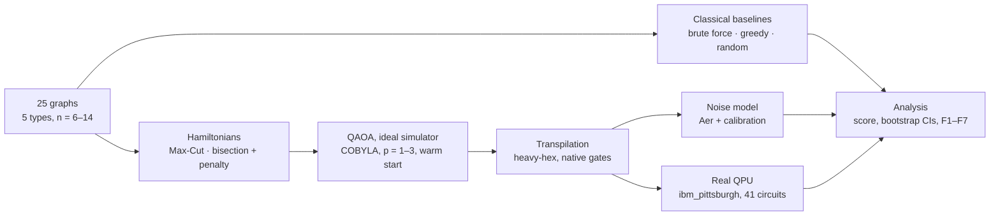

# Quantum vs. classical graph partitioning for process placement

Benchmarking QAOA on real IBM quantum hardware against exact, greedy and random baselines, for splitting a set of communicating processes across two machines.


*ring_14, Max-Cut, p = 2: random guessing cuts 7 of 14 edges on average, ideal QAOA 11.7, the real QPU (ibm_pittsburgh) 11.0.*

---

## The problem

A distributed application is a graph: processes are nodes, and an edge joins two processes that communicate.
Placing the processes on two machines splits the graph in two. A good placement balances the load (the same number of processes on each machine)
and keeps communication between machines low. This is **minimum bisection**, an NP-hard problem.

The project compares it with **Max-Cut**, the standard benchmark for the Quantum Approximate Optimization Algorithm (QAOA). Max-Cut has no constraint
and maps naturally to a quantum circuit; bisection needs its balance constraint added as a penalty term. Running both on the same graphs
isolates what a constraint costs a quantum algorithm, on a simulator and on real hardware.

## Research questions

| | question | answered in |
|---|---|---|
| **Q1** | Without noise, how close does QAOA get to the optimum, and does it improve with more layers? | F1 |
| **Q2** | How much of that quality survives on a real QPU, and can it be predicted before running? | F2, F7 |
| **Q3** | On the QPU, does QAOA find the optimal partition more often than random guessing? | F3 |
| **Q4** | How does it compare with classical methods? | F4 |
| **Q5** | How much harder is bisection than Max-Cut on the same graph? | F5 |

## Key results

- **Max-Cut works on real hardware up to 14 qubits.** The QPU samples the optimal partition **up to ~500× more often** than random guessing,
  and the second QAOA layer is worth its extra noise (n = 14: score 0.50 at p = 2 vs. 0.28 at p = 1).
- **The balance constraint is the bottleneck.** The penalty couples every pair of qubits, so bisection circuits need **4–9× more two-qubit gates** than Max-Cut
  on the same sparse graph. At 14 qubits, bisection drops to random level on two of three graphs.
- **Noise can be bracketed before running.** A noise model built from the device calibration explains **~48%** of the measured loss and is always optimistic;
  the estimated success probability (ESP) is almost always pessimistic but ranks circuits correctly (correlation **0.84**). 29 of 38 predictions made before running were correct.
- **The results are robust.** 95% bootstrap intervals over the shots are ±0.01 in score; repeating three circuits a day later changed scores by ≤ 0.02.
- **No quantum advantage at this size.** A greedy heuristic finds every optimum for n ≤ 14. The value of the experiment is a careful measurement
  of how QAOA behaves, and where it breaks, on current hardware.

| ideal vs. noise model vs. real QPU (Q2) | QPU vs. random guessing (Q3) |
|---|---|
|  |  |

Full answers, with all numbers and confidence intervals: [`results/conclusions.md`](results/conclusions.md).

## Method



- **Instances:** ring, grid, 3-regular, random and complete graphs with 6–14 nodes (25 graphs, fixed seed). Exact optima by brute force.
- **Quantum circuits:** QAOA built from the problem Hamiltonian; angles optimised on an exact statevector simulator with COBYLA,
  10 random starts plus a warm start from the previous depth, so the energy can only improve with p.
- **Hardware:** IBM Heron processor (`ibm_pittsburgh`), chosen by median calibration values and queue length. Every circuit was transpiled with
  5 seeds and 2 Hamiltonian term orders, keeping the version with the fewest CZ gates (term order alone changed the CZ count by up to 40%).
- **QPU runs:** 36 circuits (9 graphs × 2 problems × p = 1, 2), 2 stress tests designed to fail, and 3 circuits repeated on a second day;
  4,000 shots each, about 1 minute of QPU time in total.
- **Metrics:** a normalised score S (0 = random guessing, 1 = optimal), the improvement factor over random guessing, the fraction of balanced outcomes,
  and 95% bootstrap confidence intervals for every QPU result.
- **Reproducibility without an IBM account:** every job's transpiled circuits (`.qpy`), raw counts and calibration snapshot are saved,
  and indexed in `data/qpu/manifest.csv`. All analysis runs from these files.

## Limitations

Small instances (n ≤ 14, p ≤ 3); a single backend over two days; angles optimised without noise; a deliberately conservative penalty weight;
no error mitigation. Details and next steps (constraint-preserving mixers, readout mitigation, larger graphs) are in
[`results/conclusions.md`](results/conclusions.md).

## Repository structure

```
├── src/                    reusable code
│   ├── graphs.py           instance generation and I/O
│   ├── classical.py        brute force, greedy, random-guessing statistics
│   ├── hamiltonians.py     Max-Cut and bisection Hamiltonians, penalty weight
│   ├── qaoa.py             circuits, energy, optimisation, metrics
│   ├── hardware.py         calibration, backend comparison, transpilation, ESP, job saving
│   └── metrics.py          score, metrics from counts, bootstrap
├── notebooks/              one notebook per stage, run in order
│   ├── 00_setup            first circuit on a real QPU
│   ├── 01_fundamentals     expectation values, Hamiltonians as cost functions
│   ├── 02_classical        instances and classical baselines
│   ├── 03_hamiltonians     Hamiltonians, exhaustive checks, penalty threshold
│   ├── 04_qaoa_simulator   landscapes, optimisation, metrics, angle transfer
│   ├── 05_hardware         backend choice, transpilation, noise model, QPU plan
│   ├── 06_qpu              QPU runs (submission cells are locked)
│   ├── 07_analysis         tidy results table, figures F1–F7, conclusions
│   └── 07b_noisy_simulation  noise-model simulation of all QPU circuits
├── data/                   instances, classical reference, QPU circuits, counts, calibrations
├── results/                tables produced by the notebooks, conclusions.md
├── figures/                F1–F7 (main) and S_* (supplementary)
├── tests/                  unit tests
├── JOURNAL.md              stage-by-stage log: decisions, problems, fixes
└── make_figures.py         regenerates F1–F7 from results/
```

## How to run

```bash
git clone https://github.com/<user>/qaoa-process-partitioning.git
cd qaoa-process-partitioning
python -m venv .venv && source .venv/bin/activate
pip install -r requirements.txt && pip install -e .

pytest                      # unit tests
python make_figures.py      # regenerate F1–F7 from the saved results
```

Notebooks `01`–`04` and `07` run locally from the saved data. `05`, `06` and `00` need an IBM Quantum account; the cells that submit jobs are locked,
and their results are already in `data/qpu/`, so the analysis never needs the QPU.

**Stack:** Python 3.12, Qiskit 2.x, Qiskit IBM Runtime, Qiskit Aer, NumPy, SciPy, pandas, NetworkX, Matplotlib.

---

*Ana-Maria Ghica · 2026*# qaoa-process-partitioning
